  

  
  
  

### About

I build generative AI systems and study how they break: how LLM and RAG pipelines can be manipulated, how ML models can be evaded, and how to measure defenses properly.

- B.Tech CSE (AI & ML), Adani University, class of 2027
- AI/ML Intern, **State Crime Records Bureau, Gujarat**: built a RAG-based LLM copilot for multi-portal integration
- Execution Head, **Cybersphere Club**: co-teach a hands-on security course (OSINT, recon, exploitation) to 75+ students
- Interests: LLM and RAG security, adversarial robustness, AI for cyber defense

  

### Featured research

**[Adversarial Evasion Attacks on ML Intrusion Detection](https://github.com/RohanTrivedi09/adversarial-nids-evasion)**
White-box FGSM and PGD evasion attacks on a neural NIDS (NSL-KDD); everything implemented from scratch in NumPy and gradient-checked.

| At attack budget ε = 0.3 | Detection rate |
|---|---|
| Undefended model | **1.0%** (99% of attacks evade) |
| Static FGSM adversarial training | 24.2 ± 12.9% (unstable across seeds) |
| PGD adversarial training | **51.2 ± 0.9%** |

> Takeaway: single-step training and single-step evaluation both give a false sense of security.

### Projects

| Project | Area | What it shows |
|---|---|---|
| [adversarial-nids-evasion](https://github.com/RohanTrivedi09/adversarial-nids-evasion) | Adversarial ML | Attacks + defenses for an ML intrusion detector, 5-seed evaluation, CI-tested |
| [deepfakecomputervision](https://github.com/RohanTrivedi09/deepfakecomputervision) | Media forensics | ResNet18 deepfake detector with Grad-CAM explanations and a Streamlit demo |
| [Airline-Operations-Intelligence](https://github.com/RohanTrivedi09/Airline-Operations-Intelligence) | Big data / ML | 5.8M-row PySpark + MLlib pipeline with a [live dashboard](https://airline-operations-intelligence-s7eaprmlhn8atz59qjy3nj.streamlit.app) |

### Toolbox

**Generative AI**

**Machine learning**

**Security**

**Engineering**

### Now

- Exploring LLM and RAG security: prompt injection, retrieval poisoning and data leakage in retrieval pipelines
- Looking for a **3-6 month Generative AI or AI security internship from January 2027** (remote, India, or abroad)

Certifications: IBM SkillsBuild Level Up Cybersecurity with Generative AI · AWS ML Foundations · Anthropic Claude Code 101 · Forage cybersecurity job simulations (PwC, Deloitte, Mastercard, Tata, Datacom)
